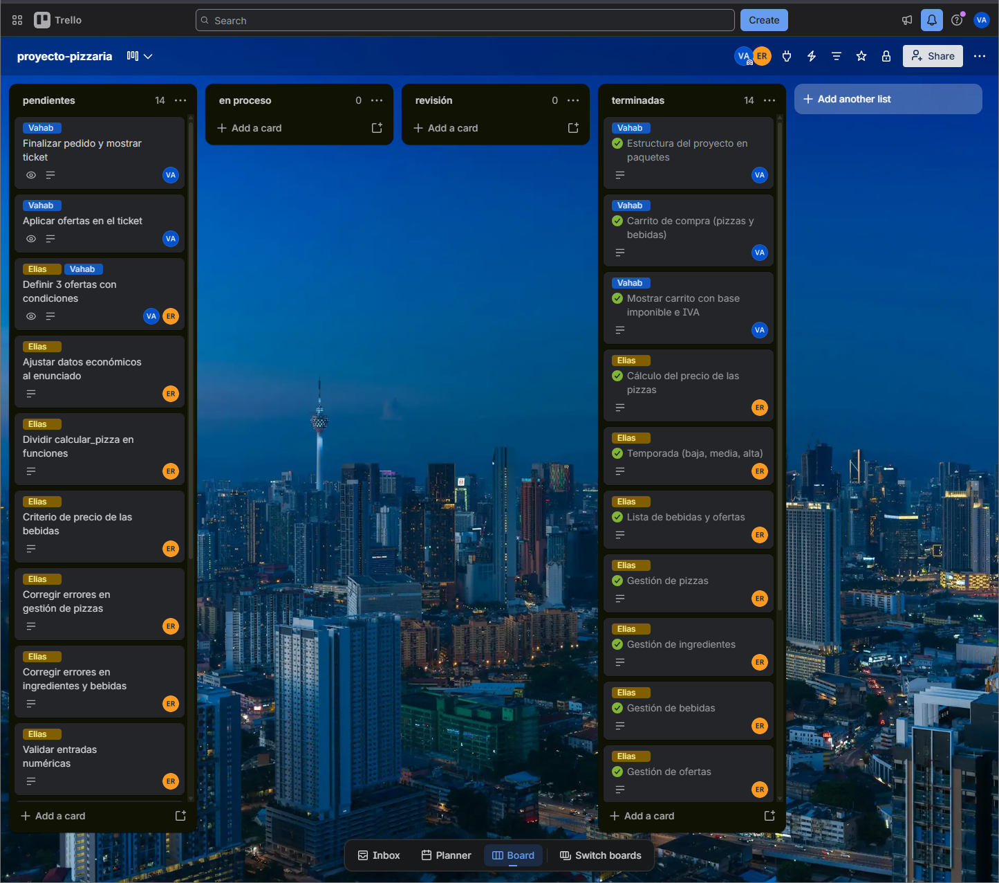
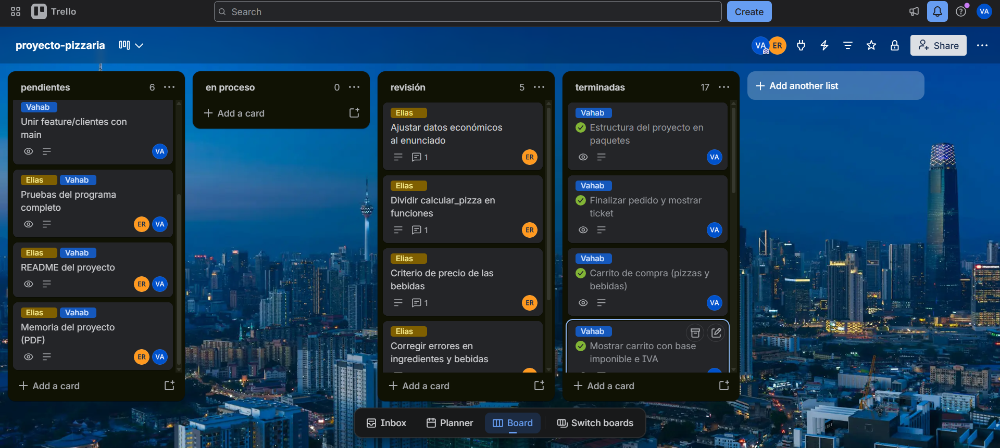
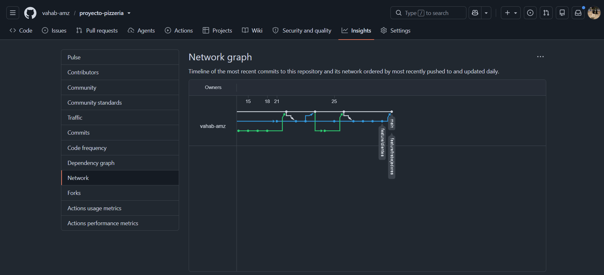
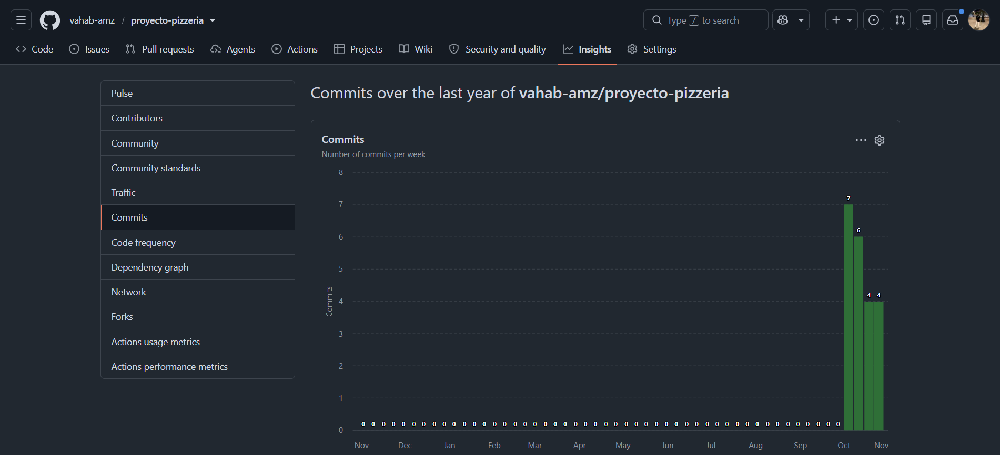

# Memoria del proyecto: Caja registradora de una pizzería

**Integrantes:** Vahab Azimzadeh · Elias Rafols
**Repositorio:** https://github.com/vahab-amz/proyecto-pizzeria
**Tablero Trello:** https://trello.com/b/6XcZJMjy/proyecto-pizzaria

---

## Índice

1. [Distribución de tareas y responsabilidades](#1-distribución-de-tareas-y-responsabilidades)
2. [Organización del trabajo](#2-organización-del-trabajo)
3. [Diario del proyecto](#3-diario-del-proyecto)
4. [Errores encontrados y cómo se resolvieron](#4-errores-encontrados-y-cómo-se-resolvieron)
5. [Cambios respecto a la idea inicial](#5-cambios-respecto-a-la-idea-inicial)
6. [Problemas de coordinación](#6-problemas-de-coordinación)
7. [Cálculo económico](#7-cálculo-económico)
8. [Estado actual](#8-estado-actual)
9. [Conclusión](#9-conclusión)

---

## 1. Distribución de tareas y responsabilidades

Desde el principio dividimos el programa en dos partes, para que cada uno trabajara en su propia carpeta y en su propia rama sin pisar el código del otro:

| Integrante | Parte | Rama | Carpeta |
|---|---|---|---|
| **Vahab** | Cliente: pedidos, carrito, ticket | `feature/clientes` | `funciones/cliente/` |
| **Elias** | Trabajador: pizzas, almacén, ofertas, cálculo de precios | `feature/trabajadores` | `funciones/trabajador/` |

Las partes compartidas (`main.py`, `listas/` y `funciones/general/`) se acordaban entre los dos antes de tocarlas.

**Tareas de Vahab**

- Tablero de Trello y su organización
- Estructura del proyecto en paquetes
- Lista de 20 pizzas e ingredientes
- Menú principal y menú del cliente
- Carrito: pedir pizzas y bebidas, con cantidades
- Ver, modificar y eliminar pedido
- Finalizar pedido y ticket (terminal y archivo .txt)
- Bucle del menú principal y opción Salir
- Revisión del código y merge de las ramas en `main`

**Tareas de Elias**

- Datos del negocio (`negocio.py`): IVA, margen y gastos
- Cálculo del precio de las pizzas (`calcular_pizza()`)
- Temporada (baja, media, alta)
- Lista de bebidas y de ofertas
- Menú del trabajador: gestión de pizzas, ingredientes, bebidas y ofertas
- Corrección de errores en la parte del trabajador

**Tareas compartidas**

- Pruebas del programa completo
- README y memoria

---

## 2. Organización del trabajo

### Trello

- Tablero `proyecto-pizzaria` con cuatro listas: **pendientes, en proceso, revisión y terminadas**.
- Cada tarjeta tiene un **responsable** (miembro asignado y etiqueta de color: azul = Vahab, amarillo = Elias), una **descripción** con los archivos afectados y un **estado**.
- Cuando uno termina una tarea la mueve a **revisión** y el otro la revisa antes de pasarla a **terminadas**.
- Los comentarios de las tarjetas se usan para explicar decisiones (por ejemplo, Elias explicó en Trello el criterio de las bebidas y de los gastos).

**Tablero el 21 de octubre**, después de reorganizarlo: 14 tareas pendientes y 14 terminadas.



**Tablero el 26 de octubre** (estado final).



### Git y GitHub

- Cada integrante trabaja en su rama (`feature/clientes` y `feature/trabajadores`).
- Para unir el trabajo se abre un **Pull Request** a `main` en GitHub. Antes de seguir trabajando, cada uno trae los cambios de `main` a su rama con `git merge main`.
- Mensajes de commit con el formato `feat:` / `fix:` / `docs:`.
- Pull Requests realizados:

| PR | Rama | Fecha | Contenido |
|---|---|---|---|
| #1 | `rama-elias` | 14 oct | Módulos de bebidas y negocio, `calcular_pizza()` |
| #2 | `feature/trabajadores` | 21 oct | Temporada, gestión de ingredientes, bebidas y ofertas |
| #3 | `feature/clientes` | 21 oct | Carrito con bebidas, modificar y eliminar pedido |
| #4 | `feature/trabajadores` | 25 oct | Correcciones de datos económicos e ingredientes |
| #5 | `feature/clientes` | 25 oct | Ticket, cantidades, ticket en .txt y bucle del menú principal |

- Las ramas antiguas `rama-vahab` y `rama-elias`, ya unidas a `main`, se borraron el 25 de octubre.

**Historial de ramas** (GitHub → Insights → Network):



**Historial de commits:**



---

## 3. Diario del proyecto

### Día 1 · Miércoles, 7 de octubre de 2026

**Resumen.** Leímos el enunciado, creamos el repositorio y el tablero de Trello, y definimos la estructura de datos de las pizzas.

**Reunión inicial y acuerdos**

- Empezar con **20 pizzas sencillas**, sin ingredientes complejos.
- Usar solo los ingredientes que da el enunciado.
- El programa tendrá un **menú principal** donde el usuario elige si es **cliente** o **trabajador**.

**Trello.** Las listas al principio eran `ToDo`, `Doing` y `Done`. Las cambiamos a **pendientes, en proceso, revisión y terminadas**, porque el enunciado pide reflejar también las tareas en revisión. Primeras tarjetas: crear base de datos, menú principal, menú trabajador y menú cliente.

**Estructura de datos de las pizzas.** Cada pizza es un diccionario y su nombre es la clave:

```python
"Margarita": {
    "nombre": "Margarita",
    "precio": None,
    "descripcion": "La clásica: tomate y queso.",
    "tamano": "mediana",
    "tipo_de_masa": "clasica",
    "ingredientes": [
        {"nombre": "harina", "cantidad": 0.25},
        {"nombre": "tomate", "cantidad": 0.10},
        {"nombre": "queso", "cantidad": 0.12}
    ]
}
```

Decisiones:

- **El precio no se escribe a mano.** Se deja en `None` y lo calcula una función.
- **Los ingredientes se miden en kg** y su precio en €/kg, así que el coste de un ingrediente es `precio_por_kg * cantidad`.
- **Tipo de masa:** la fina usa 0,20 kg de harina y la clásica 0,25 kg, por lo que la masa influye en el coste.
- **Tamaño:** de momento todas las pizzas son medianas.
- Las claves van sin tildes ni ñ (`descripcion`, `tamano`), igual que en el enunciado.

Commits del día: repositorio inicial, recetas de las 20 pizzas y precios de los ingredientes.

---

### Día 2 · Miércoles, 14 de octubre de 2026

**Resumen.** Montamos la estructura del proyecto en paquetes y empezamos cada uno con su parte.

**Estructura del proyecto (Vahab).** Organizamos el código en paquetes usando archivos `__init__.py`, que funcionan como un "índice" de cada carpeta:

```
proyecto-pizzeria/
├── main.py
├── listas/              ← datos: pizzas, ingredientes, bebidas, ofertas, negocio
└── funciones/
    ├── general/         ← funciones compartidas
    ├── cliente/         ← parte del cliente
    └── trabajador/      ← parte del trabajador
```

Así, en `main.py` basta con escribir `from funciones.cliente import menu_cliente`. También añadimos un `.gitignore` para no subir la carpeta `__pycache__`.

**Cálculo de precios y temporada (Elias).** Elias creó `listas/negocio.py` y `listas/bebidas.py`, la función `calcular_pizza()` (PR #1) y la función `temporada()`, que se elige al iniciar el programa.

**Revisión.** Al probar el programa encontramos varios errores (ver sección 4): `listar_pizzas()` fallaba al recorrer el diccionario, `gastos_luz = 6.000` se leía como 6, y el IVA no se aplicaba.

**Acuerdo de trabajo.** Cada uno solo toca su carpeta. Si hay que cambiar algo compartido, se avisa al otro antes.

---

### Días 3 y 4 · 15 y 18 de octubre de 2026

**Resumen.** Elias completó el menú del trabajador:

- Gestión de ingredientes y bebidas (añadir, eliminar, modificar y listar), dentro de un submenú **Almacén**.
- Gestión de pizzas (crear, modificar, eliminar y listar).
- Gestión de ofertas (añadir, eliminar, modificar y listar), con la lista `listas/ofertas.py`.

---

### Día 5 · Miércoles, 21 de octubre de 2026

**Resumen.** Unimos por primera vez el trabajo de los dos en `main`, completamos la parte del cliente y reorganizamos Trello.

**Merge (PR #2).** Se unió `feature/trabajadores` a `main` y después `main` a `feature/clientes`. No hubo conflictos, porque cada uno había trabajado en su carpeta.

**Carrito (Vahab).** Decidimos que cada producto del carrito sea un diccionario:

```python
{"tipo": "pizza", "nombre": "Margarita", "precio": 16.99}
```

- **`tipo`** permite tener pizzas y bebidas en el mismo carrito y saber de qué lista viene cada una.
- **`precio`** se guarda en el momento de añadir el producto. Si después el trabajador cambia un precio, el pedido ya hecho no cambia, como en una caja real.
- El precio se guarda **sin IVA**. El IVA solo se calcula al mostrar el carrito y el ticket, para no sumarlo dos veces.
- El carrito **nunca se reasigna** (`carrito = [...]`), solo se modifica con `append`, `pop`, `clear` o `carrito[i] = ...`, porque lo comparten varios archivos.

**Parte del cliente.** Los precios se muestran con 2 decimales (`:.2f`). El menú de pedido permite elegir pizza o bebida. Como el archivo `pedido.py` estaba creciendo mucho, separamos cada opción en su propio archivo:

```
funciones/cliente/
├── carrito.py            ← carrito compartido y funciones comunes
├── pedido.py             ← pedir pizzas y bebidas
├── listar_pedido.py
├── modificar_pedido.py   ← una pizza se cambia por otra pizza, una bebida por otra bebida
├── eliminar_pedido.py    ← quitar un producto o vaciar el carrito
└── menu.py
```

El carrito tiene su propio archivo para que todos los demás lo importen de un solo sitio y no haya importaciones circulares.

**Trello.** Reorganizamos el tablero: 14 tarjetas con lo que ya estaba hecho pasaron a **terminadas** y creamos 14 tarjetas en **pendientes** con todo lo que faltaba, cada una con responsable y descripción.

**Merge (PR #3).** Se unió `feature/clientes` a `main`.

**Revisión y correcciones (Elias).** A partir de las tarjetas de revisión, Elias corrigió en su rama:

- IVA del 21 % al **10 %**, alquiler a **1600 €** y temporada alta a **1500 pizzas**, como en el enunciado.
- Las cantidades de las pizzas nuevas se piden en **kg** en lugar de gramos.
- No se puede eliminar un ingrediente que usa alguna pizza.
- Mensaje de error al intentar eliminar una bebida que no existe.

Decisiones que Elias explicó en Trello:

- **Bebidas:** los precios de `bebidas.py` son **precios de venta**.
- **Gastos:** no se usa `gasto_suministros_por_pizza`, porque los gastos del local, la luz y el personal ya se reparten entre las pizzas estimadas del mes (ver sección 7).
- **Una sola función de cálculo:** prefiere mantener `calcular_pizza()` como una función que calcula todos los precios de golpe. El error de división por cero no puede ocurrir, porque la temporada se elige al principio.

---

### Día 6 · Domingo, 25 de octubre de 2026

**Resumen.** Terminamos la parte del cliente y el bucle del menú principal.

**Merge (PR #4).** Se unieron las correcciones de Elias a `main` y después `main` a `feature/clientes`.

**Finalizar pedido y ticket (Vahab).** Nueva opción "5. Pagar / Finalizar pedido" en el menú del cliente:

1. Calcula la base imponible con `calcular_total_carrito()`.
2. Muestra el total con IVA y pide confirmación (s/n). Si el cliente cancela, el carrito no cambia.
3. Muestra el ticket y vacía el carrito.

`mostrar_ticket()` recibe la base imponible como parámetro en lugar de calcularla. Así, en una versión futura se podrán aplicar descuentos entre el cálculo del total y el ticket sin cambiar la función.

**Cantidades.** Cada producto del carrito guarda ahora su `cantidad`. Si el cliente pide un producto que ya está en el carrito, se suma a la misma línea. Se puede cambiar la cantidad desde "Modificar pedido" y quitar unidades desde "Eliminar pedido". La cantidad se valida (de 1 a 20).

**Ticket en archivo.** Queríamos guardar el ticket en PDF, pero para eso hace falta una librería externa (`fpdf` o `reportlab`) y el enunciado no lo permite. Por eso el ticket se guarda como **.txt** en `tickets/ticket_AAAAMMDD_HHMMSS.txt`, usando solo `open()` y la librería estándar (`os`, `datetime`). El texto del ticket se construye una sola vez como lista de líneas, que se imprime en la terminal y se escribe en el archivo. La carpeta `tickets/` está en el `.gitignore`.

**Bucle del menú principal.** Antes, al elegir "0. Volver" en el menú del cliente o del trabajador, el programa se cerraba. Ahora:

- La temporada se elige una sola vez al principio.
- `main()` repite el menú principal hasta que se elige "0. Salir".
- `calcular_pizza()` se llama en cada vuelta. Así el cliente ve los precios nuevos si el trabajador cambia un ingrediente, y las pizzas nuevas ya tienen precio en lugar de `None`.
- El carrito no se vacía al volver al menú principal.

**Merge (PR #5)** de `feature/clientes` a `main`, y se borraron las ramas antiguas `rama-vahab` y `rama-elias`.

---

### Día 7 · Lunes, 26 de octubre de 2026

**Reunión sobre las ofertas.** Decidimos que la aplicación de ofertas en el ticket se hará en la **siguiente versión del proyecto**, en la que reorganizaremos el código con clases y objetos. En esta versión se mantiene la gestión de ofertas del trabajador (añadir, eliminar, modificar y listar), pero las ofertas no se aplican al pedido del cliente.

---

## 4. Errores encontrados y cómo se resolvieron

| Fecha | Error | Causa | Solución |
|---|---|---|---|
| 7 oct | La tarjeta "Crear base de datos" | El enunciado prohíbe bases de datos | Los datos se guardan en diccionarios y listas |
| 7 oct | El carrito estaba en el menú del trabajador | Reparto inicial de las opciones | Se movió a la parte del cliente |
| 14 oct | `listar_pizzas()` daba `TypeError: string indices must be integers` | `for pizza in pizzas` recorre las **claves** del diccionario (los nombres), no las pizzas | `for pizza in pizzas.values()` |
| 14 oct | `gastos_luz = 6.000` valía 6 | En Python el punto es decimal, no separador de miles | Escribir los números sin separador (`3000`) |
| 14 oct | El IVA se leía pero no se aplicaba | La variable `iva` no se usaba en ninguna operación | El IVA se calcula al mostrar el carrito y el ticket |
| 14 oct | Riesgo de conflictos en Git | Un archivo compartido se modificó desde la rama del cliente | Acuerdo: cada uno solo toca su carpeta |
| 21 oct | `from listas import bebidas` devolvía el **módulo** y no el diccionario (`TypeError: argument of type 'module' is not iterable`) | `listas/__init__.py` solo exportaba `pizzas` e `ingredientes` | Añadir `from .bebidas import bebidas` y `from .ofertas import ofertas` al `__init__.py` |
| 21 oct | Al crear una pizza, 250 g de harina costaban 300 € | Se pedía la cantidad en gramos, pero los datos están en kg | Pedir la cantidad en kg |
| 21 oct | Borrar un ingrediente usado por una pizza hacía fallar `calcular_pizza()` (`KeyError`) | La pizza seguía buscando un ingrediente que ya no existía | No se permite borrar un ingrediente que usa alguna pizza |
| 21 oct | Al borrar una bebida que no existe, el programa se quedaba preguntando sin decir nada | Faltaba el mensaje de error | Se muestra un mensaje |
| 21 oct | Al elegir una opción no válida en el pedido no pasaba nada | Faltaba el `else` | Mensaje "Opción no válida" |
| 21 oct | Las pizzas nuevas tenían `precio: None` | `calcular_pizza()` solo se llamaba al inicio | Se llama en cada vuelta del bucle principal (25 oct) |
| 25 oct | "0. Volver" cerraba el programa | `main()` no tenía bucle | Bucle `while True` y opción "0. Salir" |
| 25 oct | El título de un commit incluía el texto del cuerpo | Las comillas de `-m "..." -m "..."` se interpretaron mal en la terminal | Lección: comprobar con `git log` después de hacer commit |

---

## 5. Cambios respecto a la idea inicial

- La lista `ToDo / Doing / Done` pasó a tener cuatro estados, añadiendo **revisión**.
- La "base de datos" se sustituyó por estructuras de datos en memoria.
- El carrito se movió del menú del trabajador al del cliente.
- El carrito pasó de guardar solo nombres a guardar diccionarios con tipo, nombre, precio y, después, cantidad.
- La parte del cliente pasó de un solo archivo a un archivo por opción.
- **Datos económicos:** el margen pasó del 35 % del enunciado al **75 %**, y se añadieron los gastos de luz (3000 €/mes). En lugar del gasto de suministros por pizza, todos los gastos fijos se reparten entre las pizzas del mes (ver sección 7).
- El ticket en **PDF** se cambió por un ticket en **.txt**, porque el enunciado no permite librerías externas.
- Se añadieron las **cantidades** al pedido, que no estaban en la idea inicial.
- La **aplicación de ofertas** en el ticket se dejó para la siguiente versión del proyecto, que usará clases y objetos.

---

## 6. Problemas de coordinación

- **Archivos compartidos.** Al principio había riesgo de que los dos modificáramos el mismo archivo (`main.py`, `funciones_generales.py`) en ramas distintas y tuviéramos conflictos. Lo solucionamos acordando que cada uno trabaja solo en su carpeta, y que los cambios compartidos se avisan antes y se suben pronto a `main`.
- **Contrato entre las dos partes.** La parte del cliente depende de cosas de la parte del trabajador: el nombre de `calcular_pizza()`, que `precio` se guarde sin IVA, y la forma del diccionario `bebidas`. Lo hablamos antes de programar para que, al unir las ramas, el programa siguiera funcionando.
- **Orden de los merges.** Cada vez que uno terminaba algo, se hacía un Pull Request a `main` y el otro traía los cambios a su rama con `git merge main` antes de seguir. Así nunca hubo conflictos de Git.
- **Revisión de tareas.** Algunas tarjetas se movieron a revisión antes de que todo su contenido estuviera hecho. Por eso, antes de pasar una tarjeta a terminadas, el otro integrante comprueba en el código que todo lo de la descripción está hecho.

---

## 7. Cálculo económico

### Precio de una pizza

El precio se calcula en `calcular_pizza()` (`funciones/general/funciones_generales.py`) a partir de los datos de `listas/negocio.py`:

```python
iva = 0.10
margen_beneficio = 0.75
gastos_local = 1600            # alquiler mensual
gastos_luz = 3000              # suministros mensuales
gasto_personal_mensual = 4200
```

1. **Coste de los ingredientes:** suma de `precio_por_kg * cantidad` de cada ingrediente.
2. **Gastos fijos por pizza:** `(gastos_local + gastos_luz + gasto_personal_mensual) / pizzas_estimadas_del_mes`. Las pizzas del mes dependen de la temporada.
3. **Coste total:** ingredientes + gastos fijos por pizza.
4. **Precio sin IVA:** `coste_total * (1 + margen_beneficio)`.
5. **IVA (10 %):** se calcula al mostrar el carrito y el ticket: `base_imponible * iva`.

En lugar de `gasto_suministros_por_pizza = 0.60` del enunciado, los suministros (luz) entran en los gastos fijos mensuales y se reparten entre las pizzas del mes.

### Temporada

| Temporada | Pizzas al mes | Gastos fijos por pizza |
|---|---:|---:|
| Baja | 600 | 14,67 € |
| Media | 1000 | 8,80 € |
| Alta | 1500 | 5,87 € |

### Ejemplo: Margarita

Coste de ingredientes: 0,25 kg × 1,20 + 0,10 kg × 1,50 + 0,12 kg × 3,80 = **0,91 €**

| Temporada | Precio sin IVA | Precio con IVA |
|---|---:|---:|
| Baja | 27,25 € | 29,98 € |
| Media | 16,99 € | 18,69 € |
| Alta | 11,85 € | 13,04 € |

Con estos datos, la mayor parte del precio son gastos fijos y no ingredientes. En temporada baja hay pocas pizzas para repartir los gastos, así que el precio sube mucho.

### Bebidas

Los precios de `listas/bebidas.py` son **precios de venta** fijos y no llevan el cálculo de las pizzas.

### Carrito y ticket

- `calcular_total_carrito()` suma `precio * cantidad` de cada producto: es la **base imponible**.
- **IVA** = base imponible × 10 %.
- **Total** = base imponible + IVA.

---

## 8. Estado actual

**Hecho**

- [x] 20 pizzas, ingredientes, bebidas y ofertas en diccionarios
- [x] Cálculo del precio de las pizzas con temporada
- [x] Menú principal con bucle y opción Salir
- [x] Menú del trabajador: pizzas, ingredientes, bebidas y ofertas
- [x] Menú del cliente: pedir con cantidades, ver, modificar, eliminar y pagar
- [x] Ticket con IVA desglosado, en terminal y en archivo .txt
- [x] Trabajo unido en `main` (PR #1 a #5)

---

## 9. Conclusión

### Qué hemos aprendido

- **Organizar un programa en paquetes y archivos.** Separar los datos (`listas/`), las funciones compartidas y cada parte del programa en su carpeta hizo que el código fuera más fácil de leer y de repartir entre los dos.
- **Elegir bien las estructuras de datos.** Usar diccionarios para las pizzas y un carrito con diccionarios `{"tipo", "nombre", "precio", "cantidad"}` nos permitió añadir cosas nuevas (bebidas, cantidades, ticket) sin rehacer lo anterior.
- **Datos compartidos entre archivos.** Aprendimos que una lista o un diccionario se puede modificar desde varios archivos, pero que si se reasigna (`carrito = [...]`) cada archivo pasa a tener uno distinto.
- **Trabajar en equipo con Git.** Ramas por persona, Pull Requests a `main` y traer los cambios de `main` antes de seguir. Gracias a eso no tuvimos ningún conflicto en todo el proyecto.
- **Gestionar las tareas en Trello.** Tarjetas con responsable y descripción, y una lista de revisión en la que cada uno revisa el trabajo del otro.

### Qué ha funcionado bien

- Dividir el trabajo por carpetas (cliente y trabajador), porque cada uno podía avanzar sin depender del otro.
- Revisar el código del compañero antes de darlo por terminado: así encontramos la mayoría de los errores de la sección 4.
- Explicar las decisiones en los comentarios de Trello, que después nos sirvieron para escribir esta memoria.

### Qué haríamos diferente

- Acordar desde el primer día los datos económicos del enunciado (IVA, alquiler, temporadas), para no tener que corregirlos más tarde.
- Decidir antes de programar cómo se comunican las dos partes: nombres de funciones, si los precios llevan IVA y la forma de cada diccionario.
- Validar las entradas del usuario desde el principio, en lugar de dejarlo para el final.
- Hacer commits más pequeños y frecuentes, y revisar el mensaje con `git log` después de cada commit.
- Hacer capturas del tablero de Trello en cada fase del proyecto.

### Siguiente versión

En la próxima versión reorganizaremos el programa con **clases y objetos** y añadiremos la **aplicación de ofertas** en el ticket. La estructura actual nos lo pone fácil: `mostrar_ticket()` ya recibe la base imponible como parámetro, así que los descuentos se podrán aplicar antes de mostrar el ticket.